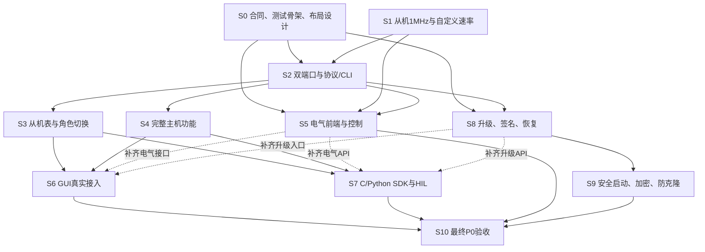

**P0 功能开发顺序与验收计划**

日期：2026-11-06。基线：`docs/uds-flash-plan @ 169acb5`。依据：[PRD 第 5/6 章](../PRD.md#L98)、[DEV_PLAN](../DEV_PLAN.md#L112)和2026-11-06 源码实现差距核对结果。

本文是建议开发计划，所有阶段均未因本文生成而视为完成。本次仅新增本文，未修改实现、PRD、DEV_PLAN 或对标工作簿，未运行硬件操作。

**顺序与范围**

推荐顺序为：先验证硬件可行性，建立双端口/协议基础，再打通从机和完整主机功能，随后完成 GUI、SDK 和产品化。电气前端、Boot/安全设计提前并行，升级和安全验证独立设门槛。

覆盖未完整落地的 19 项 P0 软件需求和 2 项 P0 电气需求；已经具备代码的 FR-MST-01、FR-APP-01、FR-FW-01 保留回归与实机验收，因此追溯表覆盖全部 24 个主优先级为 P0 的 FR ID。另纳入 PRD 的 P0 实时性、吞吐、功耗和 Windows 运行条件。

本轮不纳入 EEPROM 产品工具、通用命令序列、10 位地址、多设备并行 GUI、C#、联网升级、12V 误接、对外供电或 UDS/CAN/SPI 等后续产品功能。本机 USB 固件升级与对 ECU 的 UDS 刷写是两个独立功能。

| 步骤 | 工作 | 主要依赖 | 上板/设备 |
| --- | --- | --- | --- |
| S0 | 冻结最小合同，搭好测试骨架 | 可立即开始 | 设计不需上板；引脚/仪器准备需实物核对 |
| S1 | 先关闭 1MHz 从机和自定义速率风险 | 可立即开始 | EVK + EVKMini + 示波器/逻辑分析仪 |
| S2 | 双端口驱动、能力查询和真实 CLI 闭环 | S0、S1 | 两路独立对端；双通道波形采集 |
| S3 | 从机表接入 USB，完成无复位角色切换 | S2 | EVK + 外部主机；覆盖双路组合 |
| S4 | 补齐速率、拉伸超时、扫描和总线恢复 | S2 | 可控拉伸/NACK/SDA/SCL 故障对端 |
| S5 | 前端小板及宽电平、上拉控制 | S0、S1、S2 | 前端小板，再到 EVT；电气测量必需 |
| S6 | 把 P0 GUI 全部接到真实设备 | S3、S4 | 基础功能 EVK；电气控件随 S5 验收 |
| S7 | C/Python SDK 与正式 HIL | S3、S4 | Windows x64 + EVK；完整接口随 S5/S8/S9 补齐 |
| S8 | 本机 USB 升级、签名及掉电恢复 | S0、S2 | EVK 功能验证，最终 EVT/NOR 断电复验 |
| S9 | 安全启动、加密和防克隆 | S8 | 专用牺牲板及克隆对照板 |
| S10 | 最终 Windows、并发、长稳和电气验收 | S3、S4、S5、S6、S7、S8、S9 | 最终 EVT + Windows 10/11 + 故障/电气台架 |

表中依赖用于安排主线开始时间。S6/S7 可以先交付已具备的子集，但只有 S5/S8 等后续能力也接入后才能标为“全部 P0 完成”；它们与 S8 不构成循环依赖。单人实施默认先 S3 再 S4，多人可在 S2 稳定后并行。

**S0：冻结最小合同，搭好测试骨架**

目的：避免固件、GUI 和 SDK 各自定义端口/错误/并发语义，也避免到最后才发现 Bootloader 改变 Flash 链接布局。本步与 S1 的独立原型验证并行；安全资料未齐不阻塞普通 I2C 原型，但阻止安全布局定稿和相应阶段验收。

要改/新增的模块（以下新增名称是建议路径，不代表已经存在）：

- 新增 `docs/usb-protocol.md`：帧、命令登记、端口/能力/状态、错误、长度、期限及兼容矩阵。
- 新增 `docs/test-plan.md`、`tools/hil/run.py`、`tools/hil/adapters/cli.py`、`tools/hil/cases/`；CLI 增加稳定机器可读输出，先用 Python 标准库 subprocess 驱动，不等 Python SDK。
- 复用 [proto.rs](../host/crates/usb-i2c/src/proto.rs#L1)、[会话模型测试](../host/crates/usb-i2c/src/bridge/tests.rs)；按需要新增固件纯逻辑 host 测试入口 `firmware/tests/`。
- 新增 `docs/firmware-update-design.md`：Boot/app/暂存/元数据布局、签名覆盖、信任链、恢复入口、镜像容量预算。正式 app linker 地址冻结前完成布局评审。
- 代码仓库实际使用 GitHub；新增 CI 时用 `.github/workflows/`，跑 host 测试和可在 runner 上执行的检查。RISC-V 编译需配置实际工具链，不能用“无工具所以跳过”冒充通过。

本步推荐合同：

1. 保留当前 v1 `PING 0x01` 和 `I2C 0x10` 语义；旧 I2C 命令仍指 CH0，不把保留字节偷偷解释为 CH1。CH0 已改为从机时旧主机命令明确报错，不隐式切回主机。
2. P0 使用新增只读能力查询及显式 port 的扩展命令，单独声明扩展版本。当前 [validate_ping](../host/crates/usb-i2c/src/bridge.rs#L310)只接受版本 1，不能直接改为 2 后宣称兼容。未来 UDS 计划的命令号登记为“规划保留、未实现”；本次不修改其定义，也不以版本号推断 CAN 能力。
3. 新 host 仅在收到完整、匹配且符合旧固件格式的“不支持能力查询”回复时进入 legacy 模式；超时、错序、短包不作为降级依据。旧设备只开放 CH0/100k/基本传输。
4. 对“同时工作”采用保守验收口径：两路总线活动可重叠，不能只测交替操作。推荐先评估每端口一笔的最小双端口批次，结果逐端口返回；若确有独立提交需求，再采用有界提交/查询。它不提供脚本、任意列表、循环或延时，不扩成 P1 通用命令序列。
5. 角色/地址/速率切换只在规定边界生效。活动事务中明确 BUSY 或有界等待；失败保持原有效配置，不复位另一端口。
6. PC 表访问必须定义提交与快照语义。建议片段写成功代表整段已提交，读操作返回一致快照；同址并发写按设备确认的提交顺序判定。不能无限等总线空闲或连续返回 BUSY 导致永久无法访问，也不能用未经测量的整表长关中断替代一致性设计。持续合法的 1MHz 整表流量下，合法 PC 读/写必须在规定最大服务时间内完成；该时限是待依据 S1 延迟预算定稿的建议验收参数，不能留空后直接实现/验收。最终机制也由该预算选择。
7. 固件超时按实际时间定义，区分拉伸期限和整笔事务期限；host 总等待预算覆盖固件最大期限及有界 USB 开销。掉线后端口状态、在途操作结果和重新查询方式也要写清。保持“不自动重放有副作用操作、USB/协议失败作废会话、重连不恢复循环”。

验收：旧 v1 报文 golden vectors 保留；未知/非法命令不改变设备状态；能力支持、不支持、损坏三类测试分开；HIL 无设备返回 SKIP/ERROR，不能 PASS。每项待实现接口已有对应测试 ID、可观察结果及错误语义。此时只冻结合同，不把 mock 测试当设备能力。

准入待核实项：CH1 的控制器、引脚、连接器与复用冲突；正式 NOR 几何/容量、恢复引脚和镜像预算。当前项目没有 CH1 板级映射，不能先写死猜测 pin。

**S1：先关闭从机 1MHz 与自定义速率风险**

两个小任务可并行；不先重写完整产品框架。

- 从机：修改 [slave_proto](../firmware/slave_proto/src/main.c#L19)和 [slave_test](../tools/slave_test/src/main.c)，增加可复现速率配置、结果记录与时延测量。优先继续使用已有 ISR 方案；实测不能满足时才评估 IRQ/DMA 调整。
- 主机时序：修改 [i2c_proto](../firmware/i2c_proto/src/main.c)；建议新增可被原型和 bridge 共同编译的 `firmware/common/i2c_timing.c/.h`，对应 CMake 引用同一份实现。避免原型通过后再复制两套时序公式。
- 对端：增强 `tools/slave_test`，按需要扩展 `tools/siggen` 为可编程对端；不先假定现有 start/stop/status 已能注入拉伸。

原要求的验收：

- 从机在 100k、400k、1M 连续整表读写零错误；验证随机读、当前地址读、重复 START、0xFF 回绕及 FIFO 预取后的正确偏移。
- 10kHz–1MHz 自定义频率范围；实测 10k、50k、100k、400k、800k、1M，误差均 ≤5%。以波形确认实际频率及高低电平时序，不能只看配置寄存器。
- 记录板号、release 构建、实际时钟、接线/上拉、原始日志/波形、运行时长、错误数、ISR 最大延迟。正确接线下先复测现有 100k，再升速。

建议早期门槛：保留现有 200 轮作为冒烟，并增加每个标准速率 10 分钟连续比对。该时长是本计划建议；最终仍执行 DEV_PLAN 的长稳要求。

必须上板。EVK + EVKMini，配示波器/逻辑分析仪；每根线的上拉和目标电平按实际电路核对。EVK 3.3V 通过不代表 1.8–5V 产品前端通过。若 1MHz 无法通过，先解决实现/电气原因或形成正式需求决定，不能把静默限速算完成。

**S2：双端口驱动、能力查询和首条真实 CLI 闭环**

依赖：S0 的端口/协议合同、CH1 映射，以及 S1 的可行性结论。

要改：

- [main.c](../firmware/usb_i2c/src/main.c#L12)、[命令分发](../firmware/usb_i2c/src/usb_i2c.c#L96)和 [CMakeLists.txt](../firmware/usb_i2c/CMakeLists.txt)。
- 建议在现有工程新增 `src/i2c_port.c/.h`、`src/i2c_master.c/.h`、`src/i2c_slave.c/.h`，保存逐端口 base/IRQ/角色/配置/任务/寄存器表，不重建无关工程。
- 新增项目自己的 `firmware/boards/evk/` 板级配置，后续再加 EVT。优先在项目内封装 SDK；确需 SDK 改动时记录版本及补丁。
- host 改 [proto.rs](../host/crates/usb-i2c/src/proto.rs)、[bridge.rs](../host/crates/usb-i2c/src/bridge.rs)、[CLI](../host/crates/usb-i2c/src/main.rs)；继续使用 usb-i2c crate，不为匹配旧计划目录而改名。
- GUI 的 device/worker 先显示实际端口和能力；不支持的控件禁用。

验收：先完成 PC → CH0/CH1 基本读写 → 对端比对；非法 port、长度、角色不产生总线动作，端口数据不串扰。新 host/旧固件、旧 host/新固件、新 host/新固件均有明确测试结果。初步证明 M/M 两路活动重叠，并逐端口返回结果；一端故障不能把另一端的成功误归为失败或反之。

在此阶段就做全新 Windows 10/11 的首次枚举、免驱、PING 和基本 I2C 冒烟，尽早暴露平台问题；S10 再执行全功能矩阵。尚无 Windows 实机时，保留“平台验收待完成”，可继续 macOS/host 模型开发，不能用交叉编译替代。

USB 仍可由单 worker/单 session 串行处理控制命令；这不等于总线只能串行。双端口批次或异步端口任务需由设备实际同时推进。固定每端口最多一个任务及有界缓冲，拒绝溢出，不先引入 RTOS。

双端口批次还需覆盖：两路长事务重叠、一端 NACK 而另一端成功、一端 SCL 卡低超时而另一端仍按自身 deadline 完成。失联时逐端口保留已确认/未知结果，不重放整个批次。两笔各 256 B 写入加头部会超过当前 512 B 接收缓冲，因此必须明确最大报文、收包/分帧和独立 RX/TX 缓冲生命周期；增加 USB FS 64 B、HS 512 B 整包边界、跨包、截断和旧回复回归，不能简单扩大数组就视为完成。

必须上板；两路独立对端和波形采集是 M/M 验收前提。若现有 EVKMini 对端只支持单路，应先扩展对端或补治具，不能用 CH0→CH1 自回环代替所有组合。

**S3：从机表接入 USB，完成无复位角色切换**

依赖 S2。需求：FR-PORT-01、FR-SLV-01–05、FR-APP-10、FR-SDK-03。

要改：

- 将独立从机原型行为整合到 bridge 的 `i2c_slave`/端口上下文；保留各端口独立 256 B 表、1 B 偏移和 IRQ。
- 在 `usb_i2c.c`、Rust proto/Bridge/CLI 中新增 role、address、table read/write 等操作；命令名字/编码按 S0 定稿。
- 修改 GUI [worker](../host/crates/gui/src/worker.rs#L38)、app、[从机页面](../host/crates/gui/src/i2c/slave.rs#L158)，把目前禁用的同步入口接入实际 worker，并区分本地草稿与设备快照。

验收：

- PC 写整表/任意片段 → 外部主机读回一致；外部主机写 → PC 刷新一致。
- 长度 1/255/256、偏移 0/1/254/255、精确到末尾及越界；USB 片段访问的越界语义与 I2C EEPROM 回绕语义分别测试，不混用。
- 设置合法 7 位地址后仅目标地址应答；非法/保留地址按冻结规则拒绝。
- 在 Idle、写事务、重复 START、读事务、USB 失联时请求切换，核对 BUSY/完成/结果未知与状态回读。不得通过整机复位实现切换。
- 按 S0 一致性合同注入 PC 与外部主机交错访问，以提交记录/可控对端顺序计算唯一预期结果；不能只做两边轮流操作。持续合法的 1MHz 外部访问期间，测量 PC 读/写成功完成时间，须满足已定最大服务时间；重复 BUSY 不能作为通过。
- M/S、S/M、S/S 真实并发；切换/配置 CH0 不复位 CH1。S1 的标准速率数据完整性在 USB 压力下重测。

必须上板。状态机及边界可先 host 测；FIFO/ACK、外部主机访问和切换波形须实体板。不要仅凭 `volatile` 判定并发访问安全。

**S4：补齐主机速率、拉伸超时、扫描和恢复**

依赖 S2；可与 S3 并行。需求：FR-MST-02–06（上拉由 S5 完成）、FR-APP-06、FR-SDK-03。

要改：bridge 内 `i2c_master`、共享 timing、port/protocol；Rust Bridge/CLI；GUI [扫描/恢复演示](../host/crates/gui/src/i2c/master.rs#L216)替换为真实 worker 操作；增强 [siggen](../tools/siggen/src/main.c#L39)的参考从机和故障注入。

| 子功能 | 可在 host 验收 | 必须上板的 oracle |
| --- | --- | --- |
| 速率 | 范围、时钟/分频计算、无解拒绝、配置回读 | S1 的六个速率误差 ≤5%，最终前端再复验 |
| 拉伸超时 | 时间单位、范围、总 deadline、错误映射 | 对端拉伸 10ms 仍能通信；阈值以内成功，超过阈值按已定义时限失败；SCL 永久低有界结束 |
| 扫描 | 0x08–0x77 范围、结果集合、取消/超时边界 | 已知多地址集合完全一致；用地址阶段探测并 STOP，不额外写寄存器数据；对端内容不改变 |
| 总线恢复 | 状态转换、失败原因、端口隔离 | 开漏发送 9 个 SCL 脉冲及 STOP；确认实际 SCL/SDA 释放，之后正常传输；SDA 仍卡低或 SCL 无法升高有界失败 |

当前 SDK 启动清线不等于运行时完整恢复。扫描/恢复与现有 `CMD_I2C` 双零长度拒绝行为分开，不隐式改变旧协议。所有新增写入/配置操作继续遵守失败不自动重放。

并发压力：S4 的单功能实现和验收可以与 S3 并行；下述混合角色压力出口必须在 S3、S4 集成后执行。一路主机处于最长允许等待，另一从机仍以 1MHz 比对无误。主循环阻塞不一定饿死 ISR，先测中断屏蔽、优先级和最长 USB 延迟；预算不满足再改主机为中断/非阻塞状态机。不能先假定 DMA 或 RTOS 必需，也不能用平均耗时替代最坏延迟。

**S5：前端小板及宽电平、上拉控制（并行硬件支线）**

准备可从 S0 开始。S1 可行性有结论后进入小板，S2 接口稳定后接软件；不等 GUI/SDK 完成。需求：FR-MST-04、FR-IO-01/03/04，及功耗。

要改/新增：

- `hardware/`：前端小板到 EVT 的原理图/PCB/BOM，包含开漏电平转换、可切换上拉、VREF 测量、内部参考及保护。
- bridge 新增 `src/frontend.c/.h`，增加 `firmware/boards/evt/` 的实际 ADC/GPIO/电平控制映射。
- Rust API/CLI 和 GUI 接入 VREF、内部参考及上拉选择；无前端的 EVK capability 明确不支持，不能返回模拟成功。
- HIL 增加前端测量/配置回读用例。

验收：

- 1.8/2.5/3.3/5V 下双端口主/从均可用；100k/400k/1M 波形和上升沿达标。
- 外部 VREF 有效、缺失和异常场景；无外部参考时可明确选择内部 1.8/3.3/5V。异常输入/切换期间的动作在前端设计中定义并测试，不能由 GUI 猜测。
- 关/4.7k/2.2k 档位的实际连接和回读一致；1MHz 若需要其他阻值，按硬件评估形成明确方案，不静默降频。
- 输入扫描验证 PRD 的 VIL ≤0.3·VREF、VIH ≥0.7·VREF。
- 最终 EVT 做接触 ±4kV/空气 ±8kV ESD 和功耗 ≤200mA。ESD 的功能保持/允许复位/恢复判据在试验前明确记录，不能只凭“不损坏”判整个功能通过。

必须实物验证。此阶段可分“小板通过”和“最终 EVT 通过”两个证据状态；前端改变电容与边沿后必须重测高频和并发，不能沿用裸 EVK 的成绩。

**S6：P0 GUI 全部接真实设备**

每个 S3/S4/S5 功能的 CLI 闭环通过后就接相应页面；本步是完整收口，不要求前面先攒完所有固件。

要改：[worker.rs](../host/crates/gui/src/worker.rs)、app.rs、device.rs、i2c/mod.rs、i2c/master.rs、i2c/slave.rs。升级页面在 S8 增加独立 update 模块，不复用 UDS 模拟页。

验收：

- 端口、角色、速率、超时、地址、表读写、扫描、恢复真实可用；前端控件只在 S5 具备能力时可用。
- 页面显示“设备已应用配置”与尚未提交的草稿；成功来自设备匹配回复，不能点按钮就先改成成功。
- 断线/协议失败解除循环并清连接；重连不恢复旧循环；写/配置结果不明时显示未知并要求读回确认。
- UI 模型/点击测试覆盖正常、忙、错误、失联；实机操作与 CLI 的结果、总线波形一致。Windows 原生窗口验收和 headless 布局测试分开记录。

host 测试可独立完成；真实功能与 Windows 窗口必须在设备上验收。S5/S8 尚未完成时，本步只算对应子集完成。

**S7：C/Python SDK 与正式 HIL**

依赖已验证的 Rust API。S2 后可先搭骨架；S3/S4 后形成可用 SDK；最终跟随 S5/S8/S9 补齐 P0 控制、升级入口及状态查询。C 和 Python 可并行，Python 不依赖 C DLL。

要改/新增：

- `host/crates/sdk-c/`：cdylib、cbindgen 生成头文件、C 示例、API 文档；统一复用 usb-i2c。
- `host/crates/sdk-py/`：PyO3、maturin/pyproject、wheel、Python 示例和 pytest。
- `host/Cargo.toml` 加 workspace 成员；按真实变动更新 lockfile。
- `tools/hil/adapters/python_sdk.py` 接替早期 CLI adapter；用例与预期值保持相同，保留少量 CLI 回归。

验收：

- P0 API 覆盖矩阵无缺项，设备枚举/信息/关闭、端口/主机/从机/前端、错误与恢复规则一致；Python 的“全部 P0”覆盖不能只限定为原始读写。升级/信息入口随 S8 一并补齐。
- C ABI 使用固定宽度类型、明确 buffer 容量/实际长度、不透明有效 handle，禁止 Rust panic 穿过 ABI。两个线程同 handle、close 与传输竞争、过期 handle、短缓冲、失联后再调用有确定结果，无 UAF/deadlock。
- Python 可在干净 Windows x64 环境 pip 安装，context manager/close 行为明确；阻塞 USB 不长期占住 GIL。
- C 与 Python 示例完成同一主机/从机测试；失败码、结果未知和不自动重放语义一致。
- HIL 短版约 10 分钟、长版 1h；无设备不报通过；所有报告带固件/host 版本、板身份、配置、用例 ID、预期/实际和原始日志。

必须做 Windows runtime + 真实设备验收；仅 `cargo check --target x86_64-pc-windows-msvc` 不足以证明 C DLL 或 wheel 可用。

**S8：本机 USB 升级、签名及掉电恢复**

设计从 S0 开始，模型/host 实现可与 S3–S7 并行；正式 Flash 布局在 app/EVT 固件固定前冻结。依赖 S0/S2 的恢复/协议合同和实际 NOR 参数，不依赖 UDS 或完整 GUI。

要改/新增：

- `firmware/bootloader/`、项目所有的 linker/镜像布局输入、公共镜像头/更新状态定义、bridge 的进入升级/查询/启动确认入口。
- Rust 新增更新 API/CLI；GUI 独立 update.rs；`tools/firmware_package/` 负责可复现打包/签名，开发测试密钥与生产流程分开。
- app/恢复模式的 USB 描述符、身份关联和 Windows 免驱；占用升级设备时拒绝普通 I2C 操作。
- 故障注入测试覆盖接收、校验、提交和试启动。

方案门槛：优先采用受保护恢复入口、可恢复暂存/元数据和已验证镜像启动。A/B 还是暂存恢复由实际容量、XIP 链接/重映射和安全镜像规则决定，不假设两个地址都可直接运行。明确 NOR 擦写时 RAM 执行、cache/IRQ/watchdog 与 USB 响应限制。

验收：

- 合法镜像升级成功，重连后真实版本一致；完成发送不能直接报升级成功。
- 坏签名、错公钥、篡改、错误目标、截断/越界镜像拒绝，不能启动不可信新 app 或写保护区。
- app 损坏能进入产品 USB 恢复；host 崩溃、仅 USB 断开、真实供电中断分别测试。
- 按 FR-FW-02，升级中断电/拔线 **20 次全部可恢复**；至少分布到擦除、写入、验证、元数据提交和首次启动窗口。每次记录恢复为旧有效镜像还是可用恢复模式；用 JTAG 重刷不计产品恢复通过。
- Boot/恢复模式同样通过全新 Windows 10/11 免驱，不能让用户用 Zadig 手动替换驱动。

必须上板：先未锁定 EVK 功能验证，最终 EVT 的实际 NOR/供电再做同样中断测试。

为何提前设计：本机 SDK [flash_xip.ld](/Users/zhaojianzhi/hpm/hpm_sdk/soc/HPM6300/HPM6360/toolchains/gcc/flash_xip.ld:23) 的 app 偏移为 0x3000，而 [flash_dfu.ld](/Users/zhaojianzhi/hpm/hpm_sdk/soc/HPM6300/HPM6360/toolchains/gcc/flash_dfu.ld:10) 默认预留 0x20000。SDK [DFU 跳转](/Users/zhaojianzhi/hpm/hpm_sdk/samples/cherryusb/device/dfu/common/hpm_dfu_trigger.c:79)只检查 magic，不能当产品密码学签名验证。

**S9：安全启动、加密和防克隆**

依赖 S8 的可信更新/恢复链、HPM6360 对应版本的安全手册/打包工具，以及专门牺牲板。普通 EVK 不做 OTP/生命周期锁定，沿用 DEV_PLAN 的限制。

要改/新增：Boot/镜像工具的 ROM 信任链和加密支持；`tools/provisioning/`、生产记录、设备绑定与锁定顺序；`docs/production-provisioning.md` 和授权返修/恢复流程。复用现有 UID 序列号，但 UID 不能替代设备密钥或可信绑定。

验收：

- 可信镜像正常启动；未签名、坏签名、错误信任根、密文篡改不能启动；签名与加密分别留证据。
- 把设备 A 的原始 NOR 内容复制到未授权设备 B，B 不能运行；A 仍能合法启动及升级。也验证不同绑定参数的已配置设备。
- 完成约定生命周期配置后，允许的产品升级/恢复仍能完成；debug/readout 策略与批准流程一致。
- 相同发布包可以安装到多台授权设备，与“原始 Flash 克隆不能运行”分别测试。
- 不把“可读 UID + 相同通用签名镜像”误当防克隆；防回滚策略如需增加另明确，不把恢复回退和防降级混为一谈。

必须在专用牺牲板及对照板验证。缺供应商安全资料/工具时可继续模型、普通升级、I2C 工作，但不能关闭 FR-FW-03。本文不授权实际 OTP/锁定操作。

**S10：最终 Windows、并发、长稳和电气验收**

依赖前述功能在最终硬件上汇合。保留开发计划已有的长稳与验收要求，不新增 P1 温箱/12V 目标到本轮 P0 门槛。

要改/新增：`tools/hil/` 最终矩阵、Windows 打包/安装与 SDK 示例、`docs/test-plan.md` 结果映射、用户/API 文档及部署验收记录。正式发布前落实 app/boot 的 USB 身份和签名发布流程，开发测试 VID/PID 不直接出货。

最终通过条件：

- 全新 Windows 10/11 x64：插入免驱、设备信息、GUI、C DLL、Python wheel、全部 P0 API 实际可用。
- M/M、M/S、S/M、S/S 的标准速率组合；两端口配置/数据/错误互不串扰；双路活动用波形/对端数据验证。CH0 主机与 CH1 从机互联另作为专门自测。
- 一端最大允许拉伸/故障、另一端 1MHz 从机，并叠加 USB 表访问/控制压力，零数据错误、无无界阻塞，资源峰值在预算内。
- 依 DEV_PLAN 执行短版、1h 和最终 24h 主从长稳。保存持续吞吐与最长 host 停顿；USB 可承载带宽达到双路 1MHz 实际所需的 1.5 倍，不以“480Mbps 枚举”代替吞吐测量。
- 最终前端完成宽电平、阈值、上拉、ESD、≤200mA；升级 20 次中断恢复和锁定后合法恢复闭环。
- 每个 P0 FR ID 都有结果和原始证据；SKIP、未测、失败不能计作通过。Host 测试、Windows 编译、Windows runtime、板卡功能和电气结果分栏记录。

**P0 → 步骤 → 验收追溯**

以下 TC 名称是本计划建议的测试 ID，待在 test-plan 中落实；不是声称这些测试已经存在或通过。

| PRD ID | 实现/验收步骤 | 验收用例 |
| --- | --- | --- |
| FR-PORT-01 | S2/S3/S10 | TC-PORT-01：四种角色组合、两路重叠活动、单路故障隔离、无整机复位切换 |
| FR-SLV-01 | S3/S10 | TC-SLV-01：运行时设置 7 位地址，命中 ACK、其他地址不应答 |
| FR-SLV-02 | S1/S3/S10 | TC-SLV-02：偏移、随机/当前读、重复 START、自增/回绕 |
| FR-SLV-03 | S1/S3 | TC-SLV-03：256 B、1 B 偏移及两路独立表 |
| FR-SLV-04 | S3/S7/S10 | TC-SLV-04：PC/外部主机双向可见、并发访问与边界 |
| FR-SLV-05 | S1/S3/S5/S10 | TC-SLV-05：100k/400k/1M、最终 USB/双路负载下零错误 |
| FR-MST-01 | S2/S4/S10 | TC-MST-01：原有 7 位读/写/写后读兼容回归 |
| FR-MST-02 | S1/S4/S5/S10 | TC-MST-02：10k/50k/100k/400k/800k/1M 实测误差 ≤5% |
| FR-MST-03 | S4/S10 | TC-MST-03：10ms 拉伸成功、配置阈值内外行为和有界结束 |
| FR-MST-04 | S5/S7/S10 | TC-FE-01：上拉关/4.7k/2.2k及经评估的档位，与物理电阻/波形一致 |
| FR-MST-05 | S4/S6/S7 | TC-MST-05：0x08–0x77 纯地址扫描，已知在线集合逐项一致 |
| FR-MST-06 | S4/S6/S7 | TC-MST-06：9 clocks + STOP、持续 SDA/SCL 卡低有界失败 |
| FR-IO-01 | S5/S7/S10 | TC-FE-02：VREF 检测、内部参考、1.8/2.5/3.3/5V 主从功能 |
| FR-IO-03 | S5/S10 | TC-FE-03：VIL/VIH 对照 0.3/0.7·VREF 输入扫描 |
| FR-IO-04 | S5/S10 | TC-FE-04：最终产品接触 ±4kV / 空气 ±8kV |
| FR-APP-01 | S2/S6/S8/S10 | TC-APP-01：序列号/版本/连接状态；Windows 和升级后重新枚举 |
| FR-APP-06 | S4/S6/S10 | TC-APP-06：真实主机面板与 CLI 的总线行为一致 |
| FR-APP-10 | S3/S6/S10 | TC-APP-10：角色、地址、设备表读写；刷新显示真实读回 |
| FR-SDK-01 | S7/S10 | TC-SDK-01：C DLL、头文件/示例/文档、线程与 close 竞争 |
| FR-SDK-02 | S7/S10 | TC-SDK-02：干净环境 pip 安装，全部 P0 功能覆盖 |
| FR-SDK-03 | S2/S3/S4/S5/S7/S8 | TC-SDK-03：逐 API 覆盖、统一错误和真实执行证据 |
| FR-FW-01 | S2/S8/S10 | TC-USB-01：app/恢复模式全新 Windows 10/11 免驱 |
| FR-FW-02 | S0/S8/S10 | TC-UPD-01：合法/非法镜像、20 次升级中断全部可恢复 |
| FR-FW-03 | S0/S9/S10 | TC-SEC-01：可信启动、加密、防原始 Flash 跨板克隆、锁定后恢复 |

补充非功能用例：TC-SYS-01（USB 吞吐/停顿）、TC-SYS-02（≤200mA）、TC-SYS-03（24h 双路长稳）、TC-USB-01（Windows 免驱/断线/重连）。试用、认证与上市流程仍按 DEV_PLAN 单独管理，不从功能源码推定已完成。

**每步都采用的完成规则**

1. 先纯逻辑/协议/状态测试，再受影响固件的 release 构建和 host 检查；涉及公共协议/状态机时做 targeted regression。
2. 带“必须上板”的出口未通过时，只能记“实现已完成、验收待完成”，不能把整步关闭。
3. 固件性能构建显式使用 `-DCMAKE_BUILD_TYPE=release`；记录 SDK/工具链/提交、ELF 和板型。不得用 host 模型替代真实 FIFO、波形或电气结果。
4. 独立原型成功后必须在产品 USB、双路、前端及最终板上复验关键路径；不得只迁移代码、不迁移验证。
5. 回归强度随本步影响范围决定；同一代码/环境未变时不反复重跑相同检查。

**当前可以立即开始的三个工作包**

- S0a：协议/能力/错误合同与 CLI/HIL 骨架；落实 CH1 引脚与并发/表一致性测试定义。
- S1a/S1b：正确接线下 400k/1M 从机测试与自定义频率计算/测量。工具可先准备，接线与波形必须实际完成。
- S0b：NOR/镜像/恢复布局与安全资料核对，形成可评审设计；电气前端先准备方案，S1 风险有结论后做小板。

本次核对了当前源码接口、协议兼容限制、SDK 链接布局和 P0 覆盖；没有改动实现或重跑未变化的 host 测试。上一轮 199 项 host 测试通过仅作为已有基线，不用于宣称本计划功能通过。

Verified against: 24 个 P0 ID 覆盖、依赖无环、已有/新增模块区分、验收与上板边界；could not verify: CH1 实物映射、最终 NOR/前端、安全生命周期方案及本计划的实际硬件结果。
