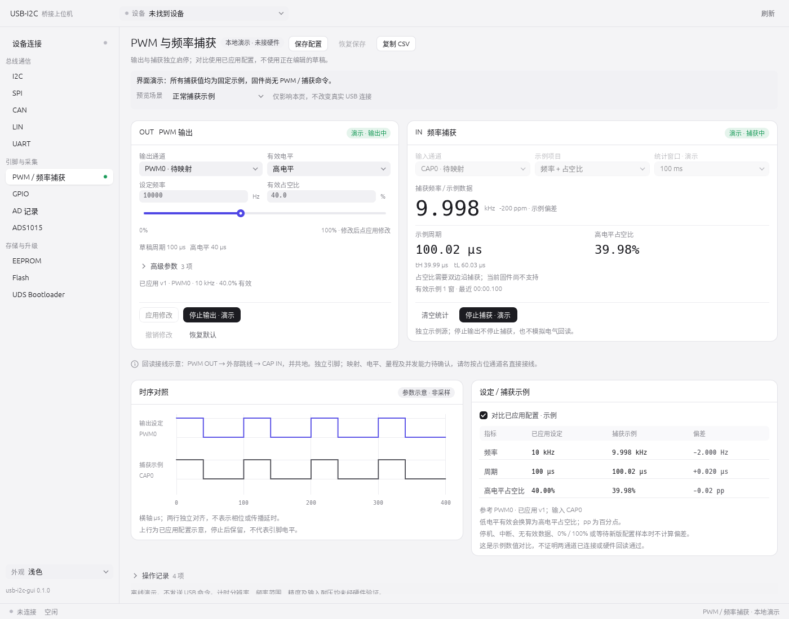

# PWM 与频率捕获合页

本次只接入上位机页面和本地演示交互，基于已合并 PR #3、#4 的 `main`（`9ac2ce8`）。没有修改固件、USB 协议、USB worker 或单桥连接方式。

## 页面布局

侧栏「PWM / 频率捕获」打开合页：

- 左侧 PWM 输出：独立输出通道、频率、有效占空比、有效电平、滑杆及高级配置。
- 右侧频率捕获：独立输入通道、仅频率 / 频率与占空比、统计窗口，以及示例频率、周期、HIGH 占空比、tH / tL。
- 下方：共用时间刻度的参数时序示意、已应用设定与捕获示例对比，以及可展开的本窗口操作记录。
- 宽窗口并排；窄窗口上下排列，可垂直滚动。沿用现有浅色、深色主题和中文字体子集。

## 页面预览

以下是生产 egui 页面几何和字体的软件渲染图，手动启动两侧演示并开启对比后的状态。不是原生窗口截图，也不是硬件实测。



[深色演示预览](images/pwm-frequency-capture-dark.png)。1200 × 800 窗口下，下方时序及对比区通过垂直滚动查看；900 × 600 下两侧面板改为上下排列。

## 当前能做什么

所有操作均不发送 USB 命令，真实 USB 桥是否连接不影响此页的演示能力。

### PWM 配置与启停

- 初始不运行、不自动生成读数。首次「启动输出 · 演示」会应用当前有效草稿；之后启动只使用已应用快照。
- 修改草稿不会改变已应用配置、上方输出示意的参考或下方比较结果；「应用修改」创建新的配置版本。
- 「停止输出 · 演示」不停止捕获。恢复默认、撤销修改、恢复保存只修改草稿，不悄悄改变已应用输出。
- 数字框保留无效文本，不会在失焦时回退到旧值并误应用。隐藏的高级参数仍参与验证。停止操作不依赖草稿是否有效。
- 频率编辑器的 1–1,000,000 Hz、占位逻辑通道 PWM0 / PWM1、停止电平、中心对齐和延时是界面选项，不是设备能力声明。启动延时和停止电平只存入配置，不模拟实际延时或引脚电平。

### 捕获演示与状态

- 独立示例源按选定的 100 / 250 / 1000 ms 窗口更新。正常示例固定为 9998 Hz、39.98% HIGH 占空比，不跟随 PWM 设定，不模拟物理回读、误差或抖动。
- 「仅频率」不显示占空比、tH / tL、占空比偏差或捕获高低电平曲线。
- 运行时锁定输入配置。停止、开始新的捕获、切换场景或清空统计立即使当前读数失效；历史记录仍有明确时间戳。
- 无信号场景显示无有效边沿，不沿用旧读数。连接中断场景停止两侧演示，正在运行的输出标为状态未知；切回正常场景后分别手动启动，不自动恢复。
- 场景选择仅影响本地页面，不连接、断开或重置真实 USB 桥。
- 清空统计移除捕获样本记录并清零计数，不改变输出或捕获启停。计数是有效示例窗口数，不是硬件边沿数。
- 切到其他页面后，演示节拍仍由应用推进。长时间未刷新只更新一个当前窗口，不补发积压。仅输出配置预览运行时不请求定时重绘。

### 对比和时序

- 对比默认关闭，需显式勾选。比较对象是已应用配置，包含通道和版本号，不是正在编辑的草稿。
- 应用新版本后等待下一份示例，避免把旧样本标作新配置下的结果。
- 低电平有效时用 `100 − 有效占空比` 换算 HIGH 占空比；频率偏差以 Hz / ppm 表示，占空比偏差以百分点 pp 表示。
- 输出停止、捕获停止、无信号、中断、尚无有效样本，以及 0% / 100% 恒定输出时不计算偏差。
- 两行曲线共用时间刻度、各自对齐，不表示相位或传播延时。它们由参数重建，不是采样波形。过密曲线省略，不画伪精细边沿。
- 输出停止后保留已应用配置的示意，明确标注不代表引脚电平。独立捕获示例继续存在不代表外部仍有信号。

### 保存和记录

- 「保存配置」保存两侧配置及对比选项，显示保存时间；「恢复保存」恢复该快照。捕获运行时需先停止，才能恢复输入配置。仅本窗口有效，关闭后不保留。
- 最多保留 200 条事件及样本记录。「复制 CSV」复制到剪贴板，不冒充导出文件。
- CSV 按时间正序，带 `local_demo` 来源、时间、事件、当时的 PWM 配置版本及全部输出参数、捕获通道/模式/窗口、场景、启停和对比开关；只有样本行带示例读数，防止操作事件复用旧数据。

## 尚未接入的硬件能力

当前 `firmware/usb_i2c/src/usb_i2c.c` 与 `host/crates/usb-i2c/src/proto.rs` 只有 PING `0x01` 和 I2C `0x10`。本页没有增加 PWM、捕获或能力查询命令。

以下均需另行实现和硬件验收：PWM 输出驱动、实际引脚映射、边沿捕获及计时基准、双边沿占空比测量、USB 配置/结果传输、溢出与无信号判定、断线后的硬件输出处置，以及输入输出并发能力。频率范围、分辨率、精度、输入耐压和接线安全均待确认。

接线图只表示将独立 PWM 输出经外部跳线接到独立捕获输入并共地的概念，不能凭 PWM0 / CAP0 名称确定板卡针脚，也不能视为电气兼容已验证。

## 验证

在 `host/` 下：

```sh
cargo test --workspace --all-targets --locked --offline
cargo test --workspace --all-targets --release --locked --offline
cargo build --release --workspace --locked --offline
cargo check --workspace --all-targets --locked --offline --target x86_64-pc-windows-msvc
cargo clippy -p usb-i2c -p usb-i2c-gui --all-targets --locked --offline -- -D warnings
cargo fmt -p usb-i2c-gui --check
```

本次全工作区 debug / release 各 145 项测试通过（USB 32、GUI 106、usb-speed 7），release 构建、Windows 编译检查及上述两个 crate 的严格 clippy 通过。首次改动前基线为 131 项通过。

新增状态/算术/CSV/波形回归及真实 egui 指针事件测试，并覆盖合页 6 个状态 × 2 个主题 × 3 种窗口尺寸的无显示布局与有限几何检查。保留现有 13 页全局渲染测试、USB 会话和单桥回归。中文字体子集按新文案重新生成。

无实体设备，未进行真实 PWM / 捕获、电气或精度验证。无显示布局、软件渲染预览及 Windows 交叉编译检查均不等同于原生窗口或板卡验收。完整工作区 `cargo fmt --all --check` 仍在未修改的 `usb-i2c/src/main.rs`、`usb-i2c/src/proto.rs`、`usb-speed/src/main.rs` 发现既有格式差异；全工作区严格 clippy 仍在 `usb-speed/src/verify.rs:69`、`usb-speed/src/main.rs:218` 报 `chunks_exact_to_as_chunks`。未将这两项报告为通过。
