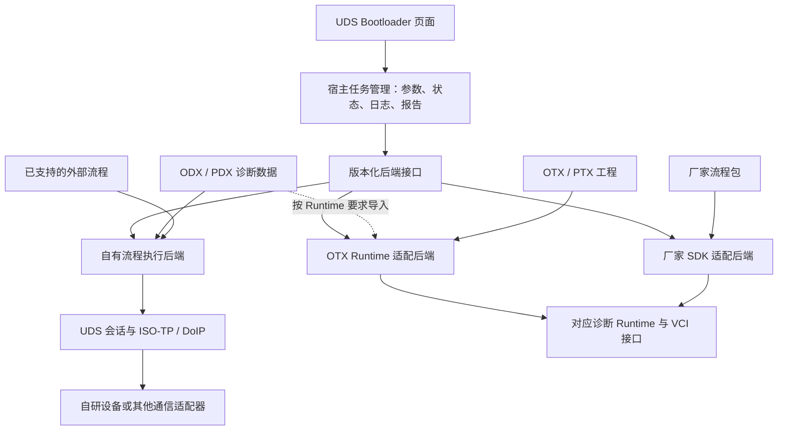

# UDS Bootloader 外部流程与插件执行方案

| 项目 | 内容 |
| --- | --- |
| 文档版本 | v0.1，待评审 |
| 日期 | 2026-11-04 |
| 源码基线 | `aa5d90e2f91015d5b389dd284cf3e117e3cd2d2f` |
| 本次交付 | 实现方案、选型依据、分阶段范围、验收要求、待确认事项 |
| 当前状态 | 仅方案；未开始实现、安装 Runtime 或执行真实刷写 |

## 1. 目标与已确认范围

将现有 UDS Bootloader 页面作为统一刷写入口，加载外部流程，按不同 ECU / Bootloader 的要求执行诊断刷写，并展示执行状态、通信记录和结果。

用户已确认的方向：

- 不同项目的刷写流程可以替换和定制，不将所有项目固定为同一组步骤。
- 优先导入已有的 ODX/OTX 或厂家流程文件。
- 本轮只形成方案并提出待确认事项，不开始开发。

推荐采用“统一宿主＋可替换执行后端”的结构。宿主统一任务操作和结果表达；各后端负责自己支持的文件格式、依赖及执行语义。首期以一种真实流程资产完成一个 ECU 的刷写闭环，其他格式逐项扩展。

本文中的“推荐”均为建议，不代表用户已确认。第 10 节记录需要用户决定的产品边界；其余接口和可靠性规则是工程设计建议。本文不修改 `PRD.md`、`DEV_PLAN.md` 或功能清单，也不构成开发、采购、发布或实际刷写授权。

## 2. 当前仓库与目标的差距

| 当前依据 | 现状 | 本方案需要的能力 |
| --- | --- | --- |
| [uds.rs](../host/crates/gui/src/uds.rs) 中的 `STAGES`、`stage_frames()` | 六个固定演示阶段，使用预置 CAN 帧；文件大小为演示常量 | 从后端获取可执行流程、参数及实际进度，不使用预置报文证明真实成功 |
| `Uds::start()`、`Uds::on_stage()` | 创建本地演示任务，点击推进阶段并追加示例记录 | 创建后台执行任务，由真实响应和执行结果推进状态 |
| [job.rs](../host/crates/gui/src/job.rs) | EEPROM、Flash、UDS 共用的演示任务和界面组件 | 保留可复用界面；真实刷写状态独立设计，避免改变其他演示页行为 |
| [worker.rs](../host/crates/gui/src/worker.rs)、[proto.rs](../host/crates/usb-i2c/src/proto.rs) | 真实通信只有 PING 和 I2C | 自有设备路径需要另行实现 CAN/ISO-TP/UDS 通信；厂家 Runtime 路径需要适配其通信接口 |

“能读入流程文件”“能执行流程”“能通过指定硬件完成刷写”分别验收，不能相互替代。

## 3. 外部文件与行业实现

### 3.1 文件层次

| 文件类型 | 可以包含的内容 | 本方案的处理方式 |
| --- | --- | --- |
| ODX / PDX，包括 ODX-F | 诊断服务、请求/响应编码、通信参数、刷写会话、数据块、镜像和相关依赖描述；PDX 用于打包 | 导入并解析引用、变体和依赖。检查是否具备实际执行所需的 Flash Job / 流程；缺失时只提供数据查看，不自行补出一套刷写顺序 |
| OTX / PTX | 可执行流程逻辑及工程资源，可以涉及分支、循环、诊断调用、外部扩展 | 检查标准版本、扩展、入口 Procedure、诊断数据和运行环境，交给匹配的 Runtime；对自有解释器仅声明已验证的支持范围 |
| 厂家流程包 | 厂家定义的流程、参数、镜像引用、算法组件或封装工程 | 有明确格式规范时实现专用导入器；依赖厂家执行环境时调用其 SDK/API |
| BIN / HEX / S19 | 镜像数据及可能的地址信息 | 作为刷写输入，不视为完整流程；与具体流程、地址映射和校验规则一起检查 |

ODX 的定位是数据模型，包含 ECU memory programming 描述；OTX 的定位是可执行序列语言与交换格式。加载一份数据文件不代表已经获得全部执行逻辑。[ASAM ODX](https://www.asam.net/standards/detail/mcd-2-d/)、[ODX Flash 模型](https://www.asam.net/standards/detail/mcd-2-d/wiki/)、[ASAM OTX](https://www.asam.net/standards/detail/otx-extensions/)

### 3.2 已核实的参考实现

| 参考 | 官方资料确认的做法 | 本项目借鉴点与限制 |
| --- | --- | --- |
| Vector vFlash | 用 Template 适配不同 Bootloader，使用 `.vflashpack` 交换工程，提供自动化 API；Custom Actions 在刷写之前或之后运行 | 借鉴统一宿主和流程包。不能将 Custom Actions 当作任意替换主流程的接口，也不假设 `.vflashpack` 是开放 OTX 格式。[官方说明](https://www.vector.com/en/product/vflash/) |
| Softing DTS.monaco | 支持 ODX-D、Flash Job、ODX-F 引用、镜像文件和 OTX 序列；提供 Runtime 集成方式 | 借鉴诊断数据、执行流程、镜像和通信接口的分层。[官方说明](https://automotive.softing.com/products/softing-dts/softing-dtsmonaco.html) |
| EMOTIVE OTX Runtime | 提供 C++/.NET/Java API、Windows/Linux 支持及独立进程运行方式；执行需要许可、诊断环境和包含所需可执行格式的 PTX | 可评估为 OTX 后端；源 OTX/PTX 可能还需 Converter，不承诺所有 OTX 文件直接运行，也未核实原生 macOS 发行支持。[Runtime](https://docs.emotive.de/OtxRuntimeCppDoc/html/_api_introduction.html)、[Converter](https://docs.emotive.de/OtxRuntimeConverterDotNetDoc/html/_runtime_converter_api_introduction.html) |
| EcuBus-Pro | 自定义诊断步骤由 `plugin.json` 和 `index.js` 组成，已有组合执行 RequestDownload、TransferData、TransferExit 的步骤 | 借鉴可复用步骤与脚本扩展；其自定义插件格式不等于 ODX/OTX 兼容。[官方说明](https://app.whyengineer.com/docs/um/uds/buildInScript/buildInScript.html) |
| odxtools / udsoncan | 前者提供 ODX 解析和编解码，已合入 ODX-F 解析与写出；后者将 UDS Client 和底层 Connection 分离 | 可评估为自有路径的组件，仍需流程执行器、厂商规则和硬件适配。[odxtools](https://github.com/mercedes-benz/odxtools)、[ODX-F 实现](https://github.com/mercedes-benz/odxtools/pull/422)、[udsoncan Connection](https://udsoncan.readthedocs.io/en/latest/udsoncan/connection.html) |

以上是公开资料支持的产品结构与接口能力，不是本仓库的集成验证结果。具体版本、许可、扩展及厂家文件兼容性仍需用实际样本确认。

## 4. 推荐架构

图中是可扩展边界，不要求首期同时实现三个后端。根据实际流程资产只选择一个首期执行后端，宿主接口为后续扩展保留边界。

### 4.1 流程资产与插件分开

- **流程资产**：用户导入的 ODX/PDX、OTX/PTX、厂家工程、镜像和算法依赖。保留原文件及其标识，不擅自改写签名包或封装格式。
- **执行后端插件**：能识别并执行某类资产的适配程序，声明支持格式、版本、操作系统、架构、Runtime 和通信接口。
- **运行快照**：一次执行选定的后端、流程入口、ECU、通信配置、参数、镜像及文件哈希。开始执行后锁定，报告使用同一快照。

执行前复核流程和镜像哈希，并通过受控副本或等效方式保证执行期间内容一致；引用内容发生变化时重新准备，不能继续使用旧检查结果。

一个后端可以服务多个 ECU 流程包；换一个流程包不必重新编译 GUI。后端登记清单只是能力和依赖说明，不替代原始流程格式。

### 4.2 宿主与后端的职责

| 层次 | 主要职责 | 边界 |
| --- | --- | --- |
| GUI | 选择流程、填写参数、显示检查结果、发起任务、展示进度和报告 | 不决定诊断报文时序，不根据按钮点击判定刷写成功 |
| 宿主任务管理 | 后端选择、运行快照、资源占用、状态转换、事件归档 | 不为不支持的格式猜测流程，不重复执行失败任务 |
| 导入与检查 | 识别格式及版本、解析引用、检查镜像/算法/Runtime 是否齐全 | 离线导入不打开总线、不执行流程中的 Job/脚本、不发 UDS 请求 |
| 执行后端 | 按已支持语义执行流程，报告真实事件和结果 | 明确自己控制通信还是委托厂家 Runtime；一台 ECU 的会话由一个后端负责 |
| 通信与设备适配 | CAN、ISO-TP、DoIP 或厂家 VCI 接口，以及设备状态 | 不因增加一个 ECU 流程而重写一套底层驱动 |

推荐通过后台进程封装 Python/C++/C# 或厂家 SDK，Rust GUI 使用版本化 IPC 接口。IPC 承担任务控制和事件传递；ISO-TP 分帧、流控及精细计时由通信后端负责，不要求 GUI 逐帧调度。

后台进程有利于隔离 SDK 崩溃和运行依赖，但不是完整安全沙箱。首期插件的信任范围见 D07。

### 4.3 后端接口草案

| 操作 | 输入与输出 | 约束 |
| --- | --- | --- |
| `capabilities` | 后端版本、支持的格式/标准版本/扩展、平台、通信接口、停止和事件能力 | 能力信息用于界面和导入前检查；不代表已通过目标 ECU 验收 |
| `inspect` | 文件引用 → 已识别内容、参数、入口、缺失依赖、不支持项 | 只做离线读取；复杂检查需要 Runtime 时明确标注，并与启动执行分开 |
| `prepare` | 选定入口、参数、镜像、目标和通信配置 → 不可变运行计划或拒绝原因 | 不执行擦除、下载或复位；需要读取 ECU 标识时进入单独的连接检查步骤 |
| `start` | 运行计划 → `run_id` 和持续事件 | 同一运行计划只启动一次；锁定其通信资源 |
| `request_cancel` | `run_id` → 停止请求已接收/不支持/仍在处理 | 接收停止请求不等于 ECU 操作已停止，更不表示回滚 |
| `result` | `run_id` → 终态、错误、执行证据、已知副作用及报告 | 后端失联时保留最后已确认信息，不生成成功结果 |

事件建议包含 `run_id`、递增序号、时间、步骤标识、级别和内容。进度应区分步骤与已确认下载字节。厂家 Runtime 未暴露步骤树、原始报文或准确百分比时，界面明确其可见粒度，不能按时间伪造完成比例。

## 5. 文件检查、界面与执行行为

### 5.1 导入与准备

1. 选择文件或工程包，识别类型、版本和来源，展示匹配的后端。
2. 离线检查引用完整性、ECU 变体、入口 Procedure/Job、镜像、算法组件和平台要求。
3. 展示可编辑参数和只读参数；参数由原始流程或后端声明，保留类型、单位、范围和默认值来源。
4. 连接指定设备，按项目规则读取 ECU 标识并匹配目标；镜像地址或 ECU 型号不匹配时阻止启动。
5. 展示最终执行计划、目标、镜像范围及缺失项；条件满足后由用户启动任务。

导入结果区分：已识别、已解析、缺少依赖、含不支持特性、已准备、可启动。只有完成实际目标验证，才记录该“文件＋Runtime＋硬件＋ECU”组合已通过验收。

遇到未知 OTX 扩展、缺失 Flash Job、无法执行的外部调用或不支持的包版本，停止准备并给出具体项，不跳过节点继续刷写。一个包包含多个 ECU 或多个入口时，必须明确选择，不能默认执行第一个。

### 5.2 流程定制

首期推荐支持导入外部流程、选择入口、调整允许修改的参数，以及重新加载外部工具编辑后的版本。运行期间保持快照不变。

是否在本软件中增加流程图编辑、脚本编辑或完整 OTX 编写能力，由 D06 决定。厂家包内部流程是否可编辑以其工具和 API 为准，不通过改扩展名或重打包绕过其格式约束。

### 5.3 状态与停止

建议任务状态为：准备中、就绪、运行中、停止处理中、成功、失败、已停止、结果未知。

- 正常执行由实际响应和后端事件推进。流程结束不自动等于镜像校验或应用验证成功，最终通过条件由项目流程明确。
- 停止在后端支持的边界处理，并记录已擦除区域、已确认下载量及尚未确认的请求。
- 超时、掉线或后端崩溃后，不自动重连并继续刷写；若无法确认带副作用请求是否完成，标记结果未知。
- 恢复或重刷从哪里开始，必须由目标 Bootloader 的能力和流程规范决定，首期不提供通用断点续刷。

## 6. 通信与刷写可靠性要求

### 6.1 自有执行路径

自有流程执行器面向完整 UDS 请求，UDS 会话层负责请求/响应关联、P2/P2*、NRC、保活和错误分类。ISO-TP 层负责分段、重组、流控和传输时序。GUI 和脚本均不绕开会话层并发操作同一 ECU。

- NRC `0x78` 按 ResponsePending 等待处理，受 P2* 及服务总等待预算约束，不能作为重发原请求的依据。
- TesterPresent 与业务请求统一调度，行为按目标要求配置，避免独立定时器与当前服务互相干扰。
- RequestDownload 返回的块长限制、TransferData 块序号及回显由执行器处理；重试仅在目标规范和该服务语义允许时启用，并有明确上限。
- 擦除、写入、校验和复位失败时，保留目标可能已变化的事实，不能以重试或重启界面掩盖未知状态。

UDS 超时与底层 Connection 分层可参考 [udsoncan Client](https://udsoncan.readthedocs.io/en/latest/udsoncan/client.html) 和 [Connection](https://udsoncan.readthedocs.io/en/latest/udsoncan/connection.html)。本节是本项目拟采用的工程约束，具体时序和重试规则仍以目标规范为准。

### 6.2 镜像与算法

- BIN 的地址来源必须明确；HEX/S19 保留原有段和地址关系，不能自行把空洞填充为待刷写数据。
- 检查地址溢出、数据块重叠、允许下载范围及保留区；多镜像顺序和相互依赖由流程描述。
- SecurityAccess、校验、签名或解密使用项目提供的实现和接口，不在 GUI 写死演示算法。
- 算法组件声明平台、架构和 ABI/运行依赖；密钥不写入流程包、普通日志或 Git。

### 6.3 厂家 Runtime 路径

厂家 Runtime 负责其诊断会话和时序时，宿主不再并行发送 TesterPresent 或其他诊断请求。宿主负责启动条件、资源独占、停止请求、状态记录和异常展示。

使用自研 USB-CAN 需要另外确认 Runtime 的设备接入方式。Softing 公布了第三方 VCI、CAN 硬件和 J2534 的集成方式；Vector 对部分第三方接口需要另行确认。当前仓库尚无该兼容性证据。[Softing D-PDU API](https://automotive.softing.com/products/softing-sde/d-pdu-api-iso-22900-2.html)、[Vector 接口支持](https://www.vector.com/en/product/vflash/)

如果后端只支持 Windows，macOS GUI 不能直接在本机运行该 SDK。远端 Windows 执行服务可作为后续选项，涉及设备归属、连接中断和部署，首期不默认纳入。

### 6.4 插件与文件边界

包解析限制文件数量、解压总量和路径，禁止目录穿越及 XML 外部实体访问。加载与执行分开，加载不能自动运行流程内脚本或外部命令；可信后端或 Runtime 的数据读取与格式校验不等于执行流程。执行时检查后端 API 版本和依赖，记录流程、镜像及插件哈希。

首期推荐只加载项目组维护的本地后端。面向任意第三方插件时，权限模型、签名更新和更严格的隔离需要单独设计；不把后台进程本身当作沙箱。

## 7. 首期建议范围与后续扩展

| 首期推荐纳入 | 后续按实际需求扩展 |
| --- | --- |
| 一个真实流程来源、一个执行后端、一个目标 ECU 的闭环 | 更多厂家格式、OTX 扩展及版本 |
| 外部文件加载、依赖检查、参数绑定和运行快照 | 内置完整流程编辑器或 OTX 编写工具 |
| 单 ECU、单通道；协议随首个样本确认 | 多 ECU 并行、跨 ECU 更新协调 |
| 真实执行状态、停止语义、异常记录和报告 | 远程执行服务、自动化 CLI、产线集成 |
| 目标使用的镜像格式及算法接口 | 其他镜像容器、签名算法和安全提供方 |
| 正常刷写及关键故障验证 | Bootloader 明确支持后的断点续刷 |

这里的单 ECU 范围仍允许该 ECU 必需的 Flash Driver、Application、Calibration 等多个镜像；不为了减少镜像数而改变项目规定的刷写流程。

建议新增独立的流程/后端模块，保留 `uds.rs` 的页面入口，逐步将展示与执行分开。具体 crate 划分在首个后端确定后决定。共享 `job.rs` 不直接整体替换；原有 I2C worker 和线上协议在未选择自研设备通信方案前保持原职责。

## 8. 分阶段实施与验收门槛

以下为后续实施顺序，不表示本轮已经开始执行。

| 阶段 | 工作与交付物 | 通过条件 |
| --- | --- | --- |
| P0：确定兼容样本 | 收集流程包、来源工具/版本、目标规范、镜像和算法依赖；形成支持项/缺失项清单，选定一个后端 | D01–D04 已有结论；样本可在已知参考工具中运行，或有明确的接口规范和预期结果；Runtime/硬件接入可行 |
| P1：宿主与离线导入 | 实现后端协议、导入结果、参数绑定、快照和模拟后端事件 | 不支持项能阻止启动；GUI 不阻塞；原有演示和 I2C 功能不受影响；模拟运行始终明确标识 |
| P2：首个真实后端 | 接入选定执行器及通信接口，完成读取标识、进入会话到完整刷写链路 | 同一目标与镜像的结果符合参考工具/目标规范；获得真实通信记录及 ECU 校验、应用版本等要求的验证结果 |
| P3：故障与回归 | 验证超时、NRC、掉线、停止、进程退出和错误镜像；形成支持组合与限制 | 故障不会被报告为成功；不会未经判断重放写入；未知结果被保留；完成适用的软件回归与目标验证 |
| P4：扩展 | 根据实际第二种资产或硬件增加后端/适配器 | 复用任务接口，独立增加兼容证据，不将首个组合的通过结论扩展到未测组合 |

若 D04 选择自研 HPM 设备优先，P2 之前必须完成其 CAN 接口、传输能力和主机适配验证；不能用当前 I2C USB 命令承载未经定义的 CAN 操作。

### 8.1 验证矩阵

| 验证层 | 必须覆盖的内容 | 证据边界 |
| --- | --- | --- |
| 离线导入 | 缺失引用、错误变体、未知扩展、版本不兼容、多入口、非法镜像地址、包解析边界 | 证明能正确识别和拒绝，不证明 ECU 可刷写 |
| 执行器/适配器 | 顺序与分支、参数绑定、NRC 0x78、超时、数据块序号、停止和进程失联 | 使用可控响应模型；模拟结果与实机报告分开 |
| 原生 GUI | 加载和失败提示、运行期间锁定配置、进度粒度、停止反馈、切页和窗口关闭行为 | 在实际支持的操作系统运行，不以交叉编译替代运行测试 |
| 协议与设备 | 总线时序、ISO-TP 流控、真实掉线、重新连接、错误镜像与目标不匹配 | 真实 VCI/HPM 设备及台架记录；不能由 Host 单元测试代替 |
| 首个 ECU 闭环 | 擦除、所有必需镜像下载、目标端校验、复位和应用验证 | 保存流程/镜像/后端版本、配置、通信 Trace 和 ECU 结果；缺少任一必需验证不标整体通过 |
| 既有功能回归 | I2C 会话、真实读写路径、共用组件及 EEPROM/Flash 演示 | 按受影响模块执行 targeted regression；合入前按仓库要求完成适用构建和检查 |

后端不提供原始通信记录时，通过厂商 Trace 或独立总线采集取得验收证据。任何模型结果、截图或进度到 100% 都不能代替实际刷写结果。

### 8.2 报告要求

每次运行记录：后端和 Runtime 版本、流程及镜像哈希、选择的 ECU/入口、通信配置、参数快照、步骤事件、最终状态、错误码、已确认的写入进度和仍不确定的目标状态。敏感密钥不进入普通报告。

报告明确运行模式：离线检查、模拟执行或真实硬件执行。采用厂商后端时，原始厂家报告与宿主摘要关联保存，避免转述时丢失错误或覆盖限制。

## 9. 主要风险与选型约束

| 问题 | 对项目的影响 | 处理方式 |
| --- | --- | --- |
| 文件缺少完整流程或依赖 | 能导入但不能执行 | P0 对照参考工具盘点，不通过默认固定流程补齐 |
| 商业 Runtime 的许可、平台或 ABI 不匹配 | 接口设计可行但无法部署 | 先验证实际 SDK/版本/平台；费用与使用范围由 D02、D03 决定，不依据产品页承诺可再分发 |
| 自研硬件不被 Runtime 支持 | 流程能运行但不能通过目标设备通信 | 将设备接入独立验证；按 D04 选择现成 VCI 或自研适配顺序 |
| 失败时 ECU 已部分擦除或写入 | 目标状态不完整，重复请求可能改变结果 | 明确停止和结果未知语义；恢复策略取自目标规范 |
| 后端仅提供粗粒度进度 | GUI 无法展示真实逐步骤执行 | 声明事件能力，展示实际可见粒度，保留厂家 Trace |

在实际样本、Runtime 和硬件方案明确前，不给出固定开发工期。P0 的输出应包含可执行范围、缺失依赖和据此形成的工作量估算。

## 10. 需要用户确认的事项

当前以下事项全部为**待确认**。可以按 D 编号回复；“接受推荐”只表示方案选择，后续是否开始开发另行明确。

| 编号 | 需要确认的信息或选择 | 推荐及其影响 | 状态 |
| --- | --- | --- | --- |
| D01 | 首个文件的扩展名、来源工具及版本、目标 ECU/Bootloader；是否有当前能成功刷写的参考工具和记录 | 选一个真实、已有成功基准的工程作为首个兼容样本。若还没有文件，先定位目标和供应方，暂不承诺 OTX 或厂家包兼容范围 | 待确认 |
| D02 | 是否接受商业 OTX Runtime / 厂家 SDK 作为可选后端，还是要求全部开源、自研 | 推荐允许可选商业后端，由实际文件决定是否使用；不默认购买。若要求全开源，则按已验证特性支持，不能承诺任意 OTX/厂家封装包均可执行 | 待确认 |
| D03 | 首期真实刷写的平台：Windows 优先，还是 macOS 与 Windows 都必须本机执行；是否还要求 Linux | 若采用商业后端，推荐 Windows 先完成真实闭环，macOS 先保留导入检查和模拟能力。若 macOS 本机刷写为硬要求，应在 P0 按该约束筛选后端，不以远端服务代替 | 待确认 |
| D04 | 通信硬件优先级，以及目前已有的 VCI 型号：自研 HPM 必须首期使用，还是允许先用兼容 VCI | 推荐用已有兼容 VCI 获取参考闭环，再接入自研 HPM；不假设已有 VCI，也不默认购买。若必须自研优先，先补 CAN/传输/主机适配，再验证流程执行 | 待确认 |
| D05 | 首期是否接受单 ECU、单通道；实际流程要求经典 CAN、CAN FD 还是 DoIP | 推荐单 ECU、单通道，以实际样本要求选择协议；无额外要求时先经典 CAN＋ISO-TP。若样本依赖 CAN FD/DoIP，应纳入首期，不做不兼容替代 | 待确认 |
| D06 | 流程定制是否允许先在原工具编辑后导入，还是首期必须在本软件里编辑步骤/分支/脚本 | 推荐首期支持导入、入口选择和参数修改，完整流程编辑仍在原工具完成；如要求内置编辑器，需增加编写、校验和兼容范围 | 待确认 |
| D07 | 首期插件只由自己/项目组维护，还是需要开放给任意第三方安装 | 推荐项目组维护的本地后端；开放第三方时增加发布、信任和权限机制。此项可在对外分发前确认，不影响前面的资产调研 | 待确认 |

D01–D04 决定主要技术路线；D05–D06 决定首期功能边界。当前已确认的“优先导入现有流程”不需要重复确认。

用户无需逐项决定 IPC 字段、类名、crate 划分或状态枚举。上述选择明确后，由实现阶段按本方案的职责边界和验证要求细化。

## 11. 实施前需要具备的资料

| 资料 | 用途 | 当前状态 |
| --- | --- | --- |
| 首个流程资产及来源工具/版本 | 确定格式、入口、变体、依赖和执行后端 | 尚未提供 |
| 目标 ECU / Bootloader 版本及刷写规范 | 确定目标识别、会话、擦除、校验、停止/恢复行为 | 尚未提供 |
| 对应镜像、地址布局及算法接口说明 | 确定文件解析、区域检查、SecurityAccess 和校验方式 | 尚未提供；密钥不写入文档或 Git |
| 参考工具的成功记录或可重复步骤 | 建立正常执行的比对依据 | 尚未提供 |
| 候选 Runtime/SDK 的版本与可用许可 | 验证编译、执行、平台和设备支持 | 尚未验证 |
| 通信硬件、目标台架和适用测试条件 | 验证真实协议与刷写结果 | 尚未确认 |

资料缺失时仍可推进不依赖它们的接口和离线研究，但不得将模拟任务、文件解析通过或模型测试通过记为真实刷写验收。
