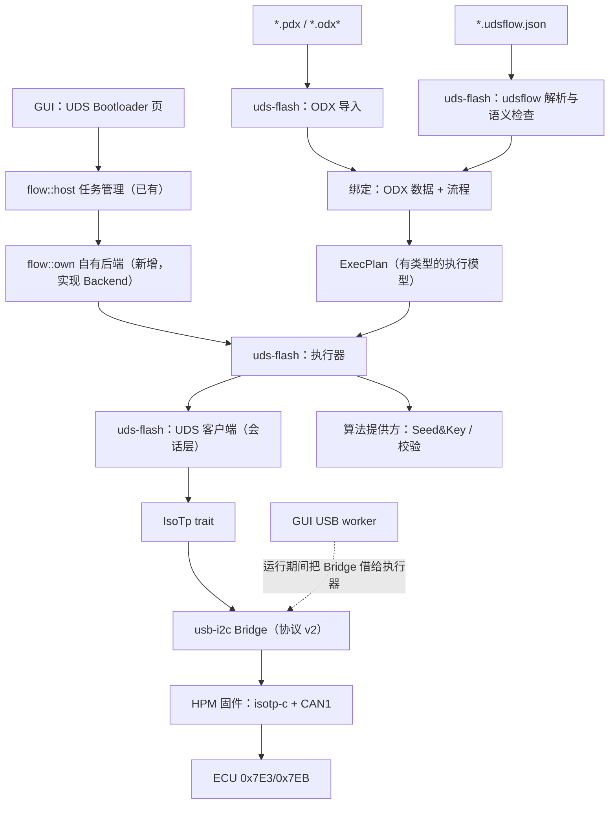

# UDS 刷写端到端实施计划

| 项目 | 内容 |
| --- | --- |
| 日期 | 2026-11-05 |
| 源码基线 | `0325c03`（另有未提交的方案 v0.2 和本组文档） |
| 上位文档 | [UDS Bootloader 方案](uds-bootloader-plugin-proposal.md)（产品边界、D01–D07） |
| 子计划 | [固件侧 ISO-TP 计划](uds-isotp-firmware-plan.md)（本文阶段 A）、[传输层调研](uds-transport-layer-survey.md) |
| 状态 | 计划，未开始实现；不修改 PRD / DEV_PLAN / 功能清单，也不构成实际刷写授权 |

## 1. 终点与验收

终点：通过自研 HPM 设备（经典 CAN 500 kbit/s），用两种入口分别对目标 ECU（请求 `0x7E3`，响应 `0x7EB`，填充 `0xAA`）完成一次完整刷写，并留下报告：

1. 自定义描述文件 `*.udsflow.json`；
2. ODX/PDX（加流程绑定，见第 8 节）。

只完成其中一条，不能算双入口完成（方案第 1 节）。每条路径的通过条件都是：

- 流程里规定的所有镜像全部下载完成；
- ECU 端校验通过；
- 复位后应用版本或标识读回符合预期；
- 报告包含：运行快照（流程、镜像、PDX、算法的 SHA-256）、步骤事件、已确认字节数、原始 CAN 帧记录、最终结论；
- 用 VN1630A 同时采集一份总线记录，与设备 trace 一致。

## 2. 已确认的决定

| 事项 | 决定 | 出处 |
| --- | --- | --- |
| 刷写通道 | 自研 HPM 设备（扩展 `usb_i2c` 固件到协议 v2）；VN1630A 只用作台架对端和总线监听 | 本轮确认，对应方案 D04 |
| 传输层位置 | 固件做 ISO-TP；上位机只收发完整 UDS PDU | 本轮确认 |
| 总线 | 首期只验收经典 CAN；代码支持 CAN FD，FD 标为未验证 | 本轮确认，对应 D05 |
| 原始帧 | 首期就上传带时间戳的收发帧 | 本轮确认 |
| 入口 | ODX/PDX 和自定义描述文件两个入口，都要规划到细节 | 本轮确认；方案已有双入口要求 |
| 目标 ECU | `0x7E3` / `0x7EB` / 填充 `0xAA`；其余资料后续提供 | 用户提供 |

## 3. 总体架构



| 层 | 位置 | 职责 | 不做的事 |
| --- | --- | --- | --- |
| 固件 ISO-TP | `firmware/usb_i2c` | 分帧、流控、N_Bs/N_Cr 超时、填充、原始帧记录 | 不理解 UDS 语义 |
| Bridge v2 | `host/crates/usb-i2c` | USB 会话、CAN/ISO-TP 命令、失败即作废会话 | 不重试任何请求 |
| UDS 客户端 | `host/crates/uds-flash`（新） | 请求与响应配对、P2/P2*、NRC 0x78、抑制正响应、TesterPresent | 不决定流程顺序 |
| 执行器 | 同上 | 按 ExecPlan 执行步骤、下载、停止边界、结果分类、事件 | 不猜测缺失的步骤 |
| 导入器 | 同上 | udsflow 解析、ODX/PDX 导入、绑定、离线检查 | 离线阶段不打开总线、不运行任何代码 |
| 自有后端 | `host/crates/gui/src/flow/own.rs`（新） | 把执行器接到已有 `Backend` 接口；借用设备；报告 | GUI 不做逐帧调度 |

**为什么在进程内执行。** 方案 4.2 推荐用后台进程封装 Python/C++ 或厂家 SDK，那是为了隔离外部运行时。自有路径全部是 Rust，进程内一个专用线程就够了：`start` 立即返回，`poll` 从通道取事件，与 `Backend` 约定的“每个方法立即返回”一致。以后接厂家 SDK 时，仍按方案用独立进程。

## 4. 阶段 A：固件与传输层

见 [uds-isotp-firmware-plan.md](uds-isotp-firmware-plan.md)（F0–F4）。上层只依赖下面这个接口（`uds-flash` 定义，Bridge 和测试替身各自实现）：

```rust
pub trait IsoTp {
    /// 发送一个完整 PDU；Ok 带设备 µs 时间戳，表示最后一帧已交给 CAN 控制器。
    fn send(&mut self, pdu: &[u8], functional: bool, timeout: Duration) -> Result<u32, TpError>;
    /// 等待一个完整 PDU（带设备 µs 时间戳）；Ok(None) 表示超时没有数据。
    fn recv(&mut self, timeout: Duration) -> Result<Option<(u32, Vec<u8>)>, TpError>;
    /// 取出自上次调用以来的原始帧记录。
    fn drain_trace(&mut self) -> Result<Vec<TraceFrame>, TpError>;
}
```

`TpError` 分两类，处理方式不同：

- `Protocol(N_Result)`（码表见[固件计划 4.3 节](uds-isotp-firmware-plan.md)，名称取自 ISO 15765-2:2011 第 7.3.7 节）：会话仍可用。如果失败发生在 PDU 发完之前，ECU 不会收到完整请求；接收方向的失败（`N_TIMEOUT_Cr` / `N_WRONG_SN` / `N_UNEXP_PDU`）表示 ECU 的响应丢失，执行器按“请求已送达、响应未知”处理。
- `Link`（USB 失败或会话作废）：带副作用的请求结果一律记为“未知”。

## 5. 阶段 B1：UDS 客户端（会话层）

以下是 ISO 14229-1/-2 的语义（正文需付费，未逐条引用原文）。实现时以 ECU 规范复核。

| 行为 | 规则 |
| --- | --- |
| 配对 | 同一 ECU 同时只有一个未完成的请求。正响应 = `SID + 0x40`；负响应 = `7F SID NRC`。收到不匹配的 PDU 时记录到事件里并丢弃，不当作当前请求的响应 |
| 时序 | 先等 P2；收到 NRC 0x78 后改等 P2*，可以连续多次；整体不超过本次服务的等待预算。`session` 的正响应里带 P2（1 ms 分辨率）和 P2*（10 ms 分辨率），流程允许时采用这两个值，再加上客户端余量（USB 和总线延迟） |
| 0x78 | 只延长等待，绝不因此重发原请求 |
| 抑制正响应 | 子功能 bit7 置位时不等正响应，但仍要在 P2 内接收可能的负响应 |
| 功能寻址 | 只发单帧；只收 `0x7EB` 的响应，其他 ECU 的响应只进 trace；如需等待，按流程声明的时长 |
| TesterPresent | 只在两次请求之间、空闲时间超过设定间隔时发送（例如 `3E 80`，功能或物理寻址按流程）；不和业务请求并发 |
| 超时与 NRC 分类 | `Timeout`、`Nrc(code)`、`Unexpected`、`Tp(Protocol)`、`Tp(Link)`。分类结果交给执行器判定结论 |
| 不重试 | 会话层没有任何自动重试；需要重试的地方由执行器按流程显式声明，并且有次数上限 |

## 6. 阶段 B2：执行模型与执行器

### 6.1 ExecPlan

两个入口都生成同一个 `ExecPlan`，并且保留来源（文件、入口、步骤位置），出错时能定位到原文件。`ExecPlan` 包含：

- 目标与身份检查；
- 传输配置（直接映射到 `ISOTP_CONFIG` 和 `CAN_OPEN`）；
- 时序参数；
- 已读入内存的镜像段（地址、数据、SHA-256）；
- 算法引用；
- 已绑定的参数；
- 步骤列表（类型见第 7.5 节）。

`prepare` 生成 `ExecPlan` 后就锁定不变。`start` 前重新计算文件哈希，任何文件变化都要求重新准备（方案 4.1）。

### 6.2 下载（`download` 步骤）

每个段依次执行 `34` → 多次 `36` → `37`：

1. 发 `34`：dataFormatIdentifier（默认 `0x00`）、addressAndLengthFormatIdentifier（由流程指定，例如 `0x44`）、地址、长度。
2. 从 `74` 响应中读出 maxNumberOfBlockLength。按 ISO 14229-1，这个长度包含 SID 和块序号。每块数据长度 = min(maxNumberOfBlockLength − 2, 4095 − 2, 流程上限)。
3. `36` 的块序号从 `0x01` 开始，`0xFF` 之后回到 `0x00`；响应必须回显同一个序号。每收到一个正响应，就发一次“已确认字节”事件。
4. 收到 `77` 后，该段才算完成。
5. 遇到 NRC 0x73 / 0x71 / 0x72 / 0x24 或超时：立即失败，记下“已擦除区域、已确认字节、在途块”。只有流程显式声明且 ECU 规范允许时，才按同一序号重发上一块（默认关闭，最多 1 次）。

### 6.3 停止

- 只在边界生效：步骤之间，或下载的两个块之间。
- 已发出的请求要等到响应或超时，不会中途放弃。
- 停止后不自动执行复位或任何“恢复”步骤。

### 6.4 结论分类

| 结论 | 条件 |
| --- | --- |
| 成功 | 全部步骤完成，最后的验证步骤通过 |
| 失败 | 收到明确的 NRC、断言失败或协议错误，且没有在途的副作用请求 |
| 已停止 | 用户停止，在边界生效，没有在途请求 |
| 结果未知 | 带副作用的请求遇到 `Tp(Link)`、超时，或进程失联，无法确认是否执行 |

报告中的 `effects` 列出已确认执行的副作用（擦除、写入的段和字节数、复位）；`unconfirmed` 列出在途、无法确认的请求。

## 7. 阶段 B3：自定义描述文件 v1（`*.udsflow.json`）

### 7.1 总体规则

- UTF-8 JSON，用 `format: "uds-flow"` 和 `schema_version: 1` 识别。
- 未知字段、重复键、重复 ID、无效引用、越界数值、无上限的等待，一律拒绝。解析器对结构体用 `deny_unknown_fields`；对象重复键在解析层检测。
- 数值统一写成字符串 `"0x7E3"` 或 JSON 整数；字节串写成十六进制字符串（例如 `"10 02"`，允许空格）。
- 相对路径从流程文件所在目录解析，不允许跳出该目录。
- 只能声明执行器已知的操作，不能嵌入 shell / Python / JS。

### 7.2 顶层字段

| 字段 | 必填 | 说明 |
| --- | --- | --- |
| `format`、`schema_version`、`id` | 是 | 固定 `"uds-flow"`、`1`，再加工程 ID |
| `title` | 否 | 显示用 |
| `odx` | 否 | ODX 绑定，见第 8.4 节 |
| `target` | 是 | `name`；`identity` 为读取并断言的列表（DID + 期望值），用于连接检查 |
| `transport` | 是（`odx.use_comparams` 时可省略已由 ODX 提供的项） | 见 7.3 |
| `timing` | 是 | 见 7.3 |
| `images` | 有 `download` 引用时必填 | 见 7.4 |
| `algorithms` | 有引用时必填 | 见第 9 节 |
| `parameters` | 否 | `id, label, type(uint/bytes/ascii), len, min, max, default, editable, unit` |
| `entries` | 是，至少 1 个 | `id, title, steps`；有多个入口时必须明确选择 |

### 7.3 `transport` 与 `timing`

| 字段 | v1 取值 |
| --- | --- |
| `protocol` | 只支持 `"isotp-can"` |
| `bitrate` | 例如 `500000` |
| `id_type` | `"std11"` / `"ext29"` |
| `addressing` | 只支持 `"normal"`（扩展/混合寻址：固件协议 v2 不支持，v1 拒绝） |
| `request_id` / `response_id` / `functional_id` | 例如 `"0x7E3"` / `"0x7EB"` / `null` |
| `padding` | `"0xAA"` 或 `null` |
| `block_size`、`stmin`、`n_bs_ms`、`n_cr_ms` | 本机作为接收方时的流控参数（`stmin` 用 FC 原始字节），以及等待超时 |
| `fd` | `null`，或 `{data_bitrate, brs, tx_dl}`。v1 能解析，但标为“未验证”并给出警告 |
| `timing.p2_ms` / `p2_star_ms` | 初值 |
| `timing.adopt_session_timing` | 是否采用 `50 xx` 响应里的 P2/P2* |
| `timing.margin_ms` | 客户端余量 |
| `timing.service_budget_ms` | 单个服务的总等待上限，0x78 链也算在内 |
| `timing.tester_present` | `{enabled, interval_ms, addressing, suppress_response}` |

### 7.4 `images`

| 字段 | 说明 |
| --- | --- |
| `id`、`path`、`format` | `format` 取 `bin` / `hex` / `s19` |
| `base_address` | 只有 `bin` 需要，而且必填 |
| `regions` | 允许写入的区域 `[{start, end}]`，必填；段越界即拒绝 |
| `sha256` | 必填；与实际文件不符即拒绝 |

HEX / S19 保留原有的段和空洞，不填充（方案 6.2）。段之间重叠即拒绝。

### 7.5 步骤

公共字段：`id`（唯一）、`op`、`title`、`when`（条件，可选）。`effect` 对 `request` 和 `routine` 必填，取值 `none` / `changes_target` / `unknown`；其余操作的副作用是固定的。

| op | 字段 | 语义 |
| --- | --- | --- |
| `session` | `value` | `10 xx`；按 `timing` 规则更新 P2/P2* |
| `security_access` | `level`（奇数）、`algorithm`、`params` | `27 level` 取种子；种子全 0 视为已解锁，跳过发密钥；否则调用算法，再发 `27 level+1`。密钥不进日志 |
| `read_assert` | `did`、`expect`（`hex` / `ascii` / `mask` + `value`）、`store` | `22 did`；断言失败即步骤失败；`store` 供后续模板使用 |
| `request` | `data`（模板）或 `odx_service` + `params`、`addressing`、`suppress_response`、`expect`、`accept_nrc`、`effect`、`store` | 通用请求，例如 `28`、`85`、`2E` |
| `routine` | `control`（start/stop/results）、`routine_id`、`data`、`expect`、`effect` | `31 xx rid data`；擦除、校验、依赖检查都没有通用 ID，必须按 ECU 规范填写 |
| `download` | `source: {image}` 或 `{odx_datablock}`、`data_format_identifier`、`alfid`、`max_block`、`exit_data` | 见第 6.2 节 |
| `reset` | `type`、`suppress_response`、`wait_after_ms`（≤ 60000） | `11 type`；副作用 |
| `wait` | `ms`（≤ 60000） | 有上限的等待 |
| `poll` | 一个 `effect: none` 的请求、`until`、`interval_ms`、`max_attempts`（≤ 100） | 有上限的轮询 |

`when` 支持三种写法，引用未定义的对象时在检查阶段报错：

- `{"param": id, "equals": v}`
- `{"stored": key, "equals": hex}`
- `{"step": id, "outcome": "ok" | "skipped"}`

模板（`data` / `exit_data`）是一个元素数组，元素可以是：

- 十六进制字面量；
- `{"param": id}`；
- `{"stored": key}`；
- `{"algo": id, "over": {"image": id} | {"odx_datablock": name}, "format": "u32be"}`（校验值）；
- `{"odx_security": datablock, "field": "fw_signature" | "fw_checksum"}`（只用于 ODX 绑定）。

### 7.6 示例（结构示意，`null` 表示待 ECU 资料补齐，导入器会拒绝启动）

```json
{
  "format": "uds-flow", "schema_version": 1, "id": "ecu-7e3-app",
  "target": { "name": "ECU-7E3", "identity": [ { "did": "0xF187", "expect": null } ] },
  "transport": { "protocol": "isotp-can", "bitrate": 500000, "id_type": "std11", "addressing": "normal",
    "request_id": "0x7E3", "response_id": "0x7EB", "functional_id": null, "padding": "0xAA",
    "block_size": 0, "stmin": "0x00", "n_bs_ms": 1000, "n_cr_ms": 1000, "fd": null },
  "timing": { "p2_ms": 50, "p2_star_ms": 5000, "adopt_session_timing": true, "margin_ms": 20,
    "service_budget_ms": 60000,
    "tester_present": { "enabled": true, "interval_ms": 2000, "addressing": "physical", "suppress_response": true } },
  "images": [ { "id": "app", "path": "app.hex", "format": "hex", "regions": null, "sha256": null } ],
  "algorithms": [ { "id": "sk", "kind": "seed_key", "provider": "process", "command": null, "sha256": null, "timeout_ms": 2000 } ],
  "entries": [ { "id": "program_app", "title": "刷写 Application", "steps": [
    { "id": "ext",    "op": "session", "value": "0x03" },
    { "id": "prog",   "op": "session", "value": "0x02" },
    { "id": "unlock", "op": "security_access", "level": null, "algorithm": "sk" },
    { "id": "erase",  "op": "routine", "control": "start", "routine_id": null, "data": null, "expect": null, "effect": "changes_target" },
    { "id": "write",  "op": "download", "source": { "image": "app" }, "data_format_identifier": "0x00", "alfid": null },
    { "id": "check",  "op": "routine", "control": "start", "routine_id": null, "data": null, "expect": null, "effect": "none" },
    { "id": "reset",  "op": "reset", "type": "0x01", "suppress_response": false, "wait_after_ms": 2000 },
    { "id": "verify", "op": "read_assert", "did": null, "expect": null }
  ] } ]
}
```

真实流程可能还有功能寻址的 `28` / `85`、Flash Driver 下载、写指纹等步骤，顺序以 ECU 规范为准。上面不是通用模板。

## 8. 阶段 C：ODX / PDX 入口

### 8.1 容器与类别

- **PDX** 是 zip 包：用 `index.xml` 编目，ODX 文件后缀以 `.odx` 开头（`.odx-d/-c/-cs/-e/-f/-fd/-m/-v`）。来源：odxtools `database.py`。
- 首期解析的类别：`DIAG-LAYER-CONTAINER`、`COMPARAM-SPEC` / `COMPARAM-SUBSET`、`FLASH`。`ECU-CONFIG`、`VEHICLE-INFO-SPEC` 只列出，不使用。
- 包内的 `.jar` 等代码文件只记录，**绝不执行**。

### 8.2 ODX-F 数据模型（元素名参照 [odxtools](https://github.com/mercedes-benz/odxtools) 实现）

| 元素 | 首期使用的内容 |
| --- | --- |
| `FLASH` → `ECU-MEMS` / `ECU-MEM-CONNECTORS` | 入口 |
| `ECU-MEM` → `MEM`、`PHYS-MEM`（`PHYS-SEGMENT`：`START-ADDRESS`、`BLOCK-SIZE`、`FILLBYTE`） | 物理内存布局，作为允许写入区域的来源 |
| `MEM` → `SESSIONS`、`DATABLOCKS`、`FLASHDATAS` | — |
| `SESSION` → `EXPECTED-IDENTS`、`CHECKSUMS`、`SECURITYS`、`DATABLOCK-REFS` | 一次刷写会话包含的数据块、期望标识、校验和安全数据 |
| `DATABLOCK` → `LOGICAL-BLOCK-INDEX`、`FLASHDATA-REF`、`FILTERS`（`ADDRDEF-FILTER` / `SIZEDEF-FILTER`）、`SEGMENTS`、`TARGET-ADDR-OFFSET`（`POS-OFFSET` / `NEG-OFFSET`）、`OWN-IDENTS`、`SECURITYS` | 下载内容 |
| `SEGMENT` → `SOURCE-START-ADDRESS`、`SOURCE-END-ADDRESS` 或 `UNCOMPRESSED-SIZE` / `COMPRESSED-SIZE`、`ENCRYPT-COMPRESS-METHOD` | 每段的地址和长度 |
| `FLASHDATA` → `INTERN-FLASHDATA`（`DATA`）或 `EXTERN-FLASHDATA`（`DATAFILE`）；`DATAFORMAT`：`INTEL-HEX` / `MOTOROLA-S` / `BINARY` / `USER-DEFINED` | 数据来源 |
| `CHECKSUM` → `CHECKSUM-ALG`、地址范围、`FILLBYTE`、`CHECKSUM-RESULT` | 离线计算并比对（算法名称在已登记的算法里才能用） |
| `SECURITY` → `SECURITY-METHOD`、`FW-SIGNATURE`、`FW-CHECKSUM` | 给流程模板引用 |
| `ECU-MEM-CONNECTOR` → `SESSION-DESCS`（`SESSION-SNREF`、`DIAG-COMM-SNREF`、`DIRECTION`、`PARTNUMBER`、`PRIORITY`）、`IDENT-DESCS`、`LAYER-REFS` | 会话与诊断层的关联；`DIAG-COMM-SNREF` 指向刷写 Job |

数据映射规则：

- 每个段的目标地址 = `SOURCE-START-ADDRESS` ± `TARGET-ADDR-OFFSET`；
- 按 `FILTERS` 从 FLASHDATA 中截取数据；
- 段必须落在 `PHYS-SEGMENT` 范围内，否则拒绝。

首期拒绝：`ENCRYPT-COMPRESS-METHOD` 非空的数据块（压缩/加密数据的 `34` 长度语义需按 ECU 规范确定），以及 `USER-DEFINED` 数据格式。这两类在检查阶段报“不支持”，并给出元素路径。

### 8.3 ODX-D 和 ComParam 子集

- **诊断层：** `PROTOCOL`、`BASE-VARIANT`、`ECU-VARIANT`，按 `PARENT-REFS` 继承，遵守 `NOT-INHERITED-*`。
- **服务：** `DIAG-SERVICE` 的 `REQUEST` / `POS-RESPONSE` / `NEG-RESPONSE`。
  - 参数类型：`CODED-CONST`、`VALUE`、`PHYS-CONST`、`RESERVED`、`MATCHING-REQUEST-PARAM`、`NRC-CONST`；
  - DOP：`DATA-OBJECT-PROP` + `STANDARD-LENGTH-TYPE`（`A_UINT32` / `A_BYTEFIELD` / `A_ASCIISTRING`），`COMPU-METHOD` 只支持 `IDENTICAL`。
- **超出子集**的元素（`STRUCTURE`、`END-OF-PDU-FIELD`、`MUX`、`TABLE` 等）：只有被流程实际引用时才报“不支持”，不影响其他服务。
- **ComParam：** 已在 odxtools 中核实的名称有 `CP_CanPhysReqId`、`CP_CanRespUSDTId`、`CP_CanFuncReqId`、`CP_UniqueRespIdTable`、`CP_Baudrate`、`CP_CANFDBaudrate`、`CP_CANFDTxMaxDataLength`、`CP_TesterPresentTime`。P2、STmin、填充等参数名以 ISO 22900-2 和首个样本为准。
- **子集范围是设计假设**，拿到第一个 PDX 样本后按实际内容调整。

### 8.4 流程来源与绑定

ODX 本身描述的是数据；刷写顺序在 `SESSION-DESC` 引用的 Job 里，通常是 `SINGLE-ECU-JOB` 的 `PROG-CODE`（例如 Java）。自有后端按以下优先级判定流程来源，**不会自行补出一套顺序**（方案 3.1）：

| 情况 | 处理 |
| --- | --- |
| 有流程绑定文件（PDX 内作为附件，或用户另选的 `*.udsflow.json`，其中 `odx` 段引用了该会话） | 用自有后端执行：ODX 提供数据、服务、ComParam，绑定文件提供步骤顺序 |
| 只有 `PROG-CODE` Job，没有绑定文件 | 阻止执行，显示 Job 名称、`CODE-FILE`、`SYNTAX`，说明需要 MCD-3D / Job 运行环境（方案 D02，商业后端） |
| 两者都没有 | 只提供数据查看，报“缺少 Flash Job / 流程” |

绑定文件中的 `odx` 段：`{ "pdx": path, "sha256": ..., "layer": ECU-VARIANT 短名, "flash_session": SESSION 短名, "use_comparams": true }`。绑定规则：

- ODX 是数据源。绑定文件只能绑定参数值，或补充 ODX 里没有的步骤；
- 双方都给出某个值且不一致时（例如请求 ID）报冲突，不悄悄以哪一方为准；
- `download.source.odx_datablock` 只能引用该会话 `DATABLOCK-REFS` 里的块；
- `request.odx_service` 按 ODX 编码请求、解码响应；
- 身份检查优先用 `IDENT-DESCS` + `EXPECTED-IDENTS`。

### 8.5 安全与验证

- **zip 限制：** 文件数 ≤ 4096、解压总量 ≤ 512 MiB、单文件 ≤ 256 MiB，拒绝绝对路径和 `..`。
- **XML 解析：** 用 quick-xml，不处理 DTD，没有外部实体。
- **验证方法：**
  - 在仓库内手写最小 PDX 夹具，覆盖每个支持的元素和每类拒绝情况；
  - 开发期用 odxtools 作对照：`tools/odx_oracle/` 用 odxtools 编码同一请求，与 Rust 实现逐字节比较（只在开发时用，不随产品发布）；
  - 拿到真实样本后，再与参考工具的结果比对。
- **为什么不直接用 Rust ODX 库：** `odx-rs`（MIT）2026-08 才创建，三个月内发布了 44 个版本，crates.io 上登记的仓库也访问不到，所以只作参考。

## 9. 算法提供方

| 类型 | 首期 | 说明 |
| --- | --- | --- |
| `builtin` | 校验类：CRC32 等，具体以 ECU 规范为准 | 编进程序，有单元测试向量 |
| `process` | Seed&Key、签名 | 外部可执行文件。启动前核对 SHA-256；通过 stdin/stdout 交换一行 JSON：`{seed, level, params}` → `{key}`；有超时，非零退出码算失败；密钥和种子不写入普通日志 |
| 厂家 DLL | 后续 | 只能在 Windows 上用，而且要匹配 32/64 位；拿到供应商的接口后再定 |

算法文件不放进 Git；描述文件里只写引用和哈希（方案 6.2）。

## 10. 阶段 D：GUI 接入

- **后端选择：** UDS 页“真实执行路径”可选“模拟后端（`.udsmock`）”或“自有后端（硬件）”。模拟路径和 `host_path_never_reaches_usb_or_processes` 测试保持不变；`flow/own.rs` 是新文件，不在禁用列表里。
- **来源：** 可选 `*.udsflow.json`、`*.pdx`，或者 PDX + 绑定文件。检查结果沿用已有的“已识别 / 缺少依赖 / 不支持”展示，并补充 ODX 会话、数据块、ComParam 的只读视图。
- **连接检查：** 只执行 `target.identity` 中的只读请求。身份不符时“开始”保持禁用（方案 5.1 第 4 步）。
- **设备借用：** worker 收到借用请求后，把 `Bridge` 交给执行线程；运行期间 I2C 请求立即返回“设备正被刷写任务占用”；结束时会话仍可用就归还，否则丢弃并要求重新连接。这要求 `Bridge: Send`，实现时用编译检查确认；如果不满足，改为在 worker 线程内执行任务，运行期间立即拒绝其他 Job。
- **进度与停止：** 按步骤显示，另外单独显示已确认字节；停止语义见第 6.3 节；页面标明“真实硬件执行”。
- **报告：** 一键导出到用户选择的目录：`report.json`（快照、事件、结论、`effects` / `unconfirmed`）+ `trace.csv`。
- **API：** `flow::api` 升到 0.2。主机允许自有后端报告 `Mode::Hardware`；`RunPlan` 增加 `digests`（各文件的 SHA-256）。

## 11. 依赖（实现时固定版本，选发布满 7 天以上的版本）

| crate | 用途 | 许可 | 备注 |
| --- | --- | --- | --- |
| `serde` / `serde_json` | udsflow、报告 | MIT/Apache-2.0 | 生态标准 |
| `quick-xml` | ODX | MIT | 不处理 DTD |
| `zip` | PDX | MIT | 加第 8.5 节的限制 |
| `sha2` | 快照与校验 | MIT/Apache-2.0 | — |
| `ihex` 3.0.0 | Intel HEX | MIT OR Apache-2.0 | 2020 年发布，格式稳定，下载量约 1490 万 |
| `srec` 0.2.0 | S19 | MIT | 2020 年发布 |
| 测试工具 | python-can、python-can-isotp（Windows + VN1630A）、odxtools（开发对照） | MIT | 不随产品发布 |

## 12. 分阶段计划与验证点

| 阶段 | 内容 | 通过条件 | 对应方案阶段 |
| --- | --- | --- | --- |
| A | 固件 ISO-TP 与 Bridge v2（F0–F4） | 见子计划；F4 与真实 ECU 只读互通 | P2 的前置 |
| B | `uds-flash`：UDS 客户端、执行器、udsflow v1、镜像、算法；`tools/isotp_peer/fake_bootloader.py` | 单元测试：用脚本化的模拟 ECU（内存版 `IsoTp`，可注入时钟）覆盖每个 op、0x78 链、P2/P2*、块序号回绕、maxNumberOfBlockLength 截断、停止边界、四种结论；离线检查覆盖 7.1 的每条拒绝规则。台架：在 VN1630A 上用假 Bootloader 完整刷写，假 Bootloader 收到的数据与镜像段逐字节一致；故障注入（NRC、0x78 风暴、丢响应、错误回显、复位无响应）得到正确的结论 | P1b + P2 前半 |
| C | ODX 导入与绑定 | 夹具 PDX 覆盖支持和拒绝两类；odxtools 对照逐字节一致；用夹具 PDX + 绑定文件在假 Bootloader 上完整刷写 | P1b |
| D | GUI 接入 | `cargo test --workspace --all-targets --locked`、`cargo clippy -D warnings`、Windows `cargo check` 全部通过；在 macOS 上实机运行：连接检查、刷写假 Bootloader、停止、拔线（结论应为“结果未知”）、报告导出；I2C 页回归 | P2 |
| E1 | 真实 ECU：自定义描述文件路径 | 第 1 节的全部通过条件；有参考工具记录时比对关键请求顺序和镜像范围 | P2 |
| E2 | 真实 ECU：ODX 路径（需要该 ECU 的 PDX） | 同上；条件相同且流程等价时，两条路径的关键请求顺序、镜像范围和目标结果一致（方案 P2b） | P2b |
| F | 故障与回归 | 方案 8.1 的验证矩阵；故障不会被报告为成功，未知结果被保留，不会未经判断重放写入 | P3 |

阶段 B、C 只依赖阶段 A 的接口定义，可以先用内存模拟 ECU 开发，与 A 并行；台架部分要等 A 的 F2 完成后才能做。

## 13. 待提供资料与待决事项

| 资料 / 决定 | 需要的阶段 | 状态 |
| --- | --- | --- |
| Windows 电脑（Vector 驱动、XL Driver Library）；VN1630A 通道与接线 | A-F3、B 台架 | 待确认 |
| ECU：确认 11 位和正常寻址、功能寻址 ID、安全 DID 列表、P2/P2* | A-F4 | 待提供 |
| ECU 刷写规范：会话顺序、SecurityAccess 级别、擦除/校验 Routine ID 及数据、dataFormatIdentifier、ALFID、内存布局、复位后的验证方法 | B 的假 Bootloader 配置、E1 | 待提供 |
| Seed&Key：算法实现或供应商可执行文件 / DLL（不进 Git） | E1 | 待提供 |
| 镜像文件和期望版本 | E1 | 待提供 |
| 参考工具记录（例如有 vFlash / CANoe 许可时用 VN1630A 录一次） | E1 / E2 比对 | 待确认是否有许可 |
| 该 ECU 的 PDX；其中刷写 Job 是不是 `PROG-CODE` | C 调整子集、E2 | 待提供 |
| D02：ODX 只有 Java Job 时，是否接受商业运行环境 | E2（仅在这种情况下） | 待确认 |
| D03：真实刷写的验收平台（推荐 macOS 和 Windows 都验收） | D、E | 待确认 |
| D06：是否需要 GUI 流程编辑器（本计划不含） | 后续 | 待确认 |

## 14. 风险

| 风险 | 处理 |
| --- | --- |
| ECU 刷写规范晚于开发 | B、C 先用假 Bootloader 和夹具推进；E 阶段才依赖真实规范 |
| PDX 样本超出 ODX-D 子集，或流程只存在于 Java Job 中 | 检查阶段如实报出；按 D02 决定是否接商业后端，不做不兼容的替代 |
| `Bridge` 不满足 `Send` | 改为在 worker 线程内执行（第 10 节） |
| 0x78 长等待期间用户要停止 | 等到响应或预算耗尽；停止只在边界生效，界面显示“停止处理中” |
| 压缩/加密的数据块 | 首期拒绝；拿到 ECU 规范后再定 `34` 的长度语义 |
| 刷写中途断电或拔线 | 结论记为“结果未知”，记录已确认的进度；从哪里恢复由 ECU Bootloader 规范决定，首期不做通用断点续刷 |
